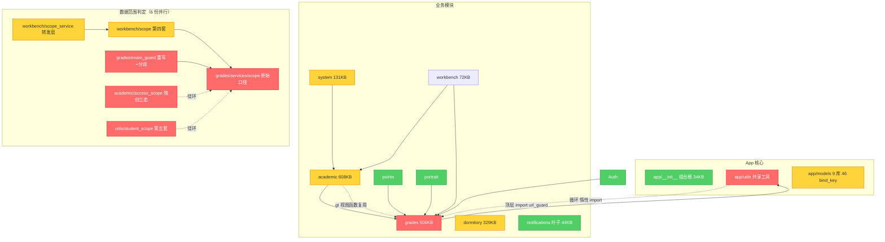

# StuLink 架构审计报告

> StuLink v1.18.9.2 · 2026-10-10
> Copyright (c) 2026 zkxxzf. Apache License 2.0
> 审计框架：Brooks-Lint Architecture Audit（六大衰变风险 + 可测试性缝 + 康威定律）

---

## 1. 审计概览

### 1.1 执行方式

采用三轮递进扫描，每轮半径扩大一层：

| 轮次 | 焦点 | 分数 | 关键产出 |
|---|---|---|---|
| Round 1 | 全局结构：模块依赖图、六大风险采样、每牛津说和存储分析 | 52/100 | 发现 utils↔grades 环 + 242 处惰性 import |
| Round 2 | 横切关注点：数据范围/权限子系统、模型层贫血度、utils 边界 | 47/100 | 发现同一安全决策被复制 6 份 |
| Round 3 | 运行时行为：数据访问模式、事务边界、缓存一致性、端点保护 | 44/100 | 发现统一入口装饰器零调用 |

**分数下降反映审计半径扩大，不是代码在三轮内劣化。** 三轮下来结构债的位置已收敛清晰。

### 1.2 一句话结论

> **这个项目的防御基座（419/421 端点受保护、CSRF 全覆盖、缓存失效纪律严谨、CSP 与会话指纹齐备）明显强于它的内部结构。** 真正的瓶颈不是"会不会被攻破"，而是"改动成本高不高"——所有已建成的抽象都只修了一半：`scope_service` 只转发 2 个函数、`scope_required` 零调用、`data_scope` 从未建立。

### 1.3 规模基线

| 维度 | 实测 |
|---|---|
| Python 文件 | 267 |
| 业务模块 | 10（academic / grades / dormitory / system / workbench / notifications / points / portrait / auth / welcome） |
| Jinja2 模板 | 122 |
| 静态 JS | 26（不含三方库） |
| 路由总数 / 未受保护 | 421 / 2（均为公开页：登录、证书核验） |
| 最大模块 | academic 608KB（28 文件） |
| 迁移脚本 | 50+（`scripts/migrate_*.py`，按日期排序无版本表） |

---

## 2. 系统结构地图

---

## 3. 核心指标看板

| 指标 | 实测值 | 风险 | 出处 |
|---|---|---|---|
| 函数级 `from app.modules.*` 惰性 import | 242 处 / 64 文件 | 🔴 | 依赖环的物理症状 |
| 静默 `except Exception: pass` | 52 处 | 🔴 | helpers 18 / schedule 19 / students 8 |
| 裸 `db.session.commit()` | 201 处 / 47 文件 | 🔴 | 多步写无回滚保护 |
| 函数超过 50 行 | 26 个（最大 352 行） | 🔴 | 违反自身 AURA 规范 |
| 数据范围判定实现份数 | 6 | 🔴 | 安全关键决策无权威口径 |
| 路由层内联角色判断 | 79 处 / 28 文件 | 🔴 | students 17 / analysis 12 |
| `scope_required` 调用次数 | **0** | 🔴 | 统一入口形同虚设 |
| 端点未受保护 | 2 / 421（均公开页） | ✅ | 覆盖良好 |
| CSRF 豁免 | 0 | ✅ | 全局 CSRF 生效 |
| 迁移脚本版本追踪 | 无（靠文件名排序） | 🟡 | batch_id 缺列 500 的根因类型 |
| 宿舍分配算法并存版本 | 4（v6 已成死代码） | 🟡 | 同一决策 4 份表达 |
| 课程표 最大路由文件 | 1658 行 | 🟡 | 业务逻辑长在路由层 |

---

## 4. 发现清单

> 遵循 Iron Law：每条发现 = Symptom → Source → Consequence → Remedy

### 4.1 🔴 Critical

#### C1 · Dependency Disorder — utils 与 grades 循环依赖，靠惰性 import 掩盖

**Symptom:** `app/utils/url_guard.py:34` 在函数内 import `grades.services.ai_providers`，而 `grades/services/ai_service.py:16` 顶部反向 import `app.utils.url_guard`；`utils/student_scope.py` ↔ `grades/services/scope.py` 同样成环。全 app 共 **242 处函数级 `from app.modules.*`**（academic 36 处、__init__ 23 处、grades 20 处），多数为绕环而推迟导入。

**Source:** Martin — *Clean Architecture*, Acyclic Dependencies Principle (ADP)

**Consequence:** import 顺序成为隐性契约，任一侧加一行顶层 import 即可能全站启动失败；惰性 import 使类型检查、静态分析、依赖追踪全部失效。这是历史上"改全局模板打挂 `/academic/teacher-links`"这类间歇故障的结构性温床。

**Remedy:** 把数据范围（`grades.services.scope`）与出站白名单配置上移为真共享内核（如 `app/services/data_scope.py` + config 项），grades 侧保留 re-export 兼容；完成后消灭两个环，惰性 import 只保留真正出于性能的少数。

---

#### C2 · Knowledge Duplication — 权限判定无权威口径（6 份实现 + 79 处内联 + 统一入口零调用）

**Symptom:** "这个用户能看哪些年级/班级"这一**安全关键决策**存在 6 个独立实现：

| # | 实现 | 位置 | 备注 |
|---|---|---|---|
| 1 | `check_exam_visible` 系 | `grades/services/scope.py` | 原始口径 |
| 2 | `assert_grade_visible` | `grades/services/exam_guard.py` | 几乎逐行重写，却**额外加了"班主任兜底放行"** |
| 3 | `class_allowed` | `workbench/services/scope.py` | 又一套分支 |
| 4 | `apply_academic_scope` | `academic/services/access_scope.py` | 独创 `{grade: set\|None}` 三态结构 |
| 5 | `apply_student_scope` | `utils/student_scope.py` | 用 `Student.id == -1` 表达空集 |
| 6 | 转发层 | `workbench/services/scope_service.py` | 注释自承"曾是两套并存，正是漂移来源"，仅转发 2 个函数即停手 |

只读证据：`TeacherSubjectLink.query.filter_by(user_id=…, active=True)` 重复 **8 次**，`UserClassLink.query.filter_by(user_id=…)` 重复 **7 次**。

雪上加霜：`app/utils/decorators.py` 定义了 `scope_required(checker, perm)` 并注明是"H-2/H-3/H-4 及后续新路由的唯一入口""同类校验不写两份（清单第 0 节铁律②）"——**全仓库 grep 仅命中它自己的定义，零调用**。与此同时路由层 28 个文件里散落 **79 处内联分支**（`system/students.py` 17 处 `if role == 'homeroom_teacher'`、`elif 'grade_leader'` 重复 6 遍）。

**Source:** Hunt & Thomas — *The Pragmatic Programmer*, DRY；Ousterhout — *A Philosophy of Software Design*, Information Leakage；Brooks — *The Mythical Man-Month*, Conceptual Integrity

**Consequence:** 246 项安全回归全绿只证明"当前这组组合能通过"，不代表新增一个角色时这 6 份还能保持同步。`exam_guard` 已与 `check_exam_visible` 产生实际分歧。每一个未被进展 lost coverage 的分支都是潜在越权入口。

**Remedy:**
1. 立即处置 `scope_required` — **删除或启用，别让它继续假装是机制**（零成本，澄清架构意图）
2. 逐条裁决 `exam_guard` 与 `check_exam_visible` 的行为差异，列清单人工决策
3. 建立 `app/services/data_scope.py` 唯一入口：`visible_grades(user)` / `class_allowed(user, grade, class_name)` / `apply_student_scope(query, user)`，其余 5 处改为 re-export 或删除
4. 按 `students.py` → `analysis.py` 顺序逐路由替换内联分支，每改一个文件同步加回归断言

---

#### C3 · Cognitive Overload — 超长函数群突破自身规范上限

**Symptom:** AST 扫描 8 个核心文件发现 **26 个函数超过 50 行**（项目 AURA 规范上限），极端者：

| 函数 | 行数 | 位置 |
|---|---|---|
| `import_students` | 352 | `system/routes/students.py:704` |
| `batch_transfer` | 134 | 同上 :1287 |
| `bulk_apply_swap` | 125 | `academic/services/swap_service.py:384` |
| `get_day_matrix` | 119 | `academic/services/schedule_service.py:725` |
| `build_live_schedule` | 84 | `academic/services/swap_service.py:1289` |
| `review_swap` | 82 | 同上 :842 |

路由巨石：`academic/routes/schedule.py` 1658 行、`system/routes/students.py` 1423 行、`dormitory/routes/rooms.py` 62KB。

**Source:** Fowler — *Refactoring*, Long Method；McConnell — *Code Complete*, Ch. 7 High-Quality Routines

**Consequence:** 352 行函数同时承担解析、校验、落库、建号四种职责，任何小改动无法局部推理，回归只能靠全量冒烟兜底——测试越全改一次越贵，最终无人敢动。此问题在 Round 1 与 Round 3 连续浮现，说明"知道"但未形成强制力。

**Remedy:** 先做低成本拆分（可作为后续工作的铺路）：
- 抽 `_read_upload_sheet(file)` 工具函数，把 students.py 与 users.py 里重复的 openpyxl 读取逻辑统一
- `import_students` 按"解析→校验→落库→回执"拆为 4 个 50 行内函数并下移到 service 层
- `bulk_apply_swap`、`get_day_matrix` 同法处理

---

#### C4 · Change Propagation — 写路径无统一事务边界，静默失败不可见

**Symptom:**
- **201 处裸 `db.session.commit()`** 分布在 47 个文件，绝大多数是路由内直接提交
- **52 处 `except Exception: pass`**（helpers 18、schedule 19、students 8），其中 20 处带 `# noqa: BLE001` 表明是明知故犯的妥协
- 典型无保护多步写：`students.py:1146` 先 `commit()` 改班级，**再**尝试 `write_change_log`，失败被 `except: pass` 吞掉 → **学生已调班但调班记录永久丢失，且无法回滚**

**Source:** Martin — *Clean Architecture*（用例边界缺失）；McConnell — *Code Complete*, Ch. 8 Defensive Programming

**Consequence:** 部分成功的写操作留下静默不一致数据。而 52 处静默 catch 保证运维看不到异常 —— 本来应报错的缺失数据（跨库 Teacher 查询失败等）变成"页面正常但数据是空的"，排查第一步就错方向。这也解释了为何必须依赖 298 项全量回归：静默失败没有 traceback，只能靠断言逐项捞。

**Remedy:**
- 对多步写（`students.transfer` / `import_*` / `apply_plan`）用 `with db.session.begin():` 或显式 try/rollback 包住整个用例
- 至少把 52 处 `pass` 换成统一的 `current_app.logger.warning(...)`（保留降级行为但留下痕迹），优先处理带 `# noqa: BLE001` 的 20 处
- 审计/日志类副作用允许在事务外，但必须告警而非静默

---

### 4.2 🟡 Warning

#### W1 · Knowledge Duplication — 宿舍分配算法四套版本并存，v6 已成死代码

**Symptom:** `room_assignment_v4`（38KB，仍被 assignments 路由引用）、`v6`（**47KB，全仓库零引用**）、`v7`（54KB，仅被 v8 import）、`v8`（生产入口）同时在库。

**Source:** Fowler — *Refactoring*, Duplicate Code；Brooks — *The Mythical Man-Month*, Second-System Effect（每代重写而非演进）

**Consequence:** 同一"分床"决策有 4 份表达，修 bug 不知该修哪份；死代码 v6 还可能被误当参考实现复制。

**Remedy:** 删除 v6；把 v4 的 `_ensure_room_beds` 迁入 v8 后合并 v4/v7 为单一模块，用 git 历史保留版本考古能力。

---

#### W2 · Change Propagation — 宿舍/表单 N+1 查询

**Symptom:** `assignments.py:927-937` 在 `for rid, beds in bed_groups.items()` 里逐房间 `Room.query.get(rid)`；同文件 9 处 `for bed/room in …` 循环内含查询。`form_summary_service.py:283` 全量 `Student.query.all()` 后在 Python 里组装（有手写 cache 部分缓解）。`forms.py:866` 循环内 `db.session.get(FormTemplate, …)` 亦是 N+1。

**Source:** Winters et al. — *Software Engineering at Google*, Ch. 21（规模意识）

**Consequence:** 数据量翻倍时响应时间非线性增长，是首屏加载慢的主因之一。

**Remedy:** 改为 `Room.query.filter(Room.id.in_(bed_groups.keys()))` 一次性取出；dormitory 与 form_summary 优先处理。

---

#### W3 · Domain Model Distortion — 模型层贫血，18 张表挤在一个文件

**Symptom:** `models/grades.py` 639 行塞了 18 张表、24 个方法，其中 11 个是 `to_dict`/`*_label` 纯展示辅助，真正领域行为几乎为零；`models/academic.py` 543 行 13 张表（横跨 4 个 bind_key）同样如此。`assignment_history.py` / `dictionary.py` / `operation_log.py` 为 0 方法纯数据袋。

**Source:** Evans — *Domain-Driven Design*, Anemic Domain Model；Fowler — *Refactoring*, Data Class

**Consequence:** 本该属于领域的行为（"这场考试某人可见吗"）全部外溢到 6 份 scope 实现——不是分散本身不好，而是**没有领域对象承载，被迫分散**。这是 C2 的成因之一。

**Remedy:** 不做完整 DDD 改造。优先：① `models/grades.py` 按聚合拆文件（Exam / ExamScore / ExamBand / TeacherSubjectLink 各自独立）；② 给 `Exam` 加 `is_visible_to(user)` 方法，把散落判定收回一处。

---

#### W4 · Accidental Complexity — utils 层身份混乱，既是 shared kernel 又依赖上层 models

**Symptom:** `app/utils/` 名义是底层工具，但 `helpers.py:6` 直接 import `app.models`、`student_scope.py:14` 同样依赖 models 且反向惰性 import `grades.services.scope`；而真正的纯函数工具（crypto / id_card / text_guard）与之混在同一目录。`helpers.py` 652 行同时承担审计日志、字典读取、毕业年级计算、导出辅助四项职责。

**Source:** Martin — *Clean Architecture*, Dependency Inversion Principle（低层工具依赖高层领域模型）

**Consequence:** 依赖方向被彻底打乱——这正是 C1 循环依赖的物理成因，不是设计选择，是目录划分没想清楚。

**Remedy:** 三向拆分：纯函数工具留 `app/utils/`；依赖 models 的领域服务（`helpers.get_graduated_grades`、`student_scope`）移入 `app/services/`；考试═scope 相关并入 `data_scope.py`。

---

#### W5 · Testability Seam — 业务逻辑长在路由层，只能整栈集成测试

**Symptom:** 352 行的 `import_students`、1658 行的 `schedule.py` 路由文件、62KB 的 `rooms.py` 内含大量业务编排。各模块虽有 services 目录，但路由层未统一走它。

**Source:** Feathers — *Working Effectively with Legacy Code*, Ch. 4 The Seam Model

**Consequence:** 没有 HTTP 上下文就无法单测这些逻辑，只能维持"临时库 + test_client 全栈跑"这一种形态（298 项回归要跑完整 app），反馈回路被锁死在最慢档位。

**Remedy:** 新增业务逻辑一律进 service（可脱离 request 单测）；存量随改动机会逐步下移，路由只做参数解析与转发。

---

#### W6 · Knowledge Duplication — openpyxl DataValidation monkeypatch 多处逐行复制

**Symptom:** `dv.DataValidation.__init__` 的 patched 版（`kw.pop('id', None)`）在 `system/routes/users.py:273-281` 与 `system/routes/students.py:726-734` 各存一份，逐行相同。

**Source:** Hunt & Thomas — *The Pragmatic Programmer*, DRY

**Consequence:** openpyxl 升级若 patch 方式失效，需多处同步修改；漏一处则该导入静默崩溃。

**Remedy:** 抽至 `app/utils/excel_patch.py` 单一位置。（约一小时工作量，同时为拆分 352 行函数铺路）

---

### 4.3 🟢 Suggestion

#### S1 · 前端巨石文件
`base.html` 45KB（含 30 处菜单高亮变量）、`schedule.js` 74KB、`grades.js` 71KB。侧栏菜单抽成 `` partial；大 JS 按页面拆分（已有 `?v=` 缓存破坏机制，成本可控）。**注意**：修改 `base.html` 前须扫描同名变量（历史事故：`` 覆盖了后端传入的 `ep` 函数导致页面 500）。

#### S2 · 迁移脚本缺版本追踪
50+ 个 `scripts/migrate_*.py` 靠文件名日期排序，schema 当前状态需人脑回放全部脚本。建议加 `schema_version` 表记录已执行脚本，启动时校验或提供 `migrate --status`；不必引入 Alembic。（`batch_id` 缺列导致 workbench 500 即为此类）

#### S3 · alumni_app 与主站 crypto 两份实现
`alumni_app/app/utils/crypto.py` 与 `app/utils/crypto.py` 独立并存。加密是安全关键决策，两份实现修一处漏一处。建议提取共享包，或至少加测试校验两份密文互通。

#### S4 · teacher_service 成为 hub 且取教师方式不唯一
`teacher_service` 被 6 个文件依赖，且存在两种取法（`Teacher.query.filter_by(user_id=)` 与 `teacher_service.teacher_of_user()` 带同名兜底启发式）。建议统一为单一入口，移除同名兜底或加日志告警——重名学校会静默取错人。

---

### 4.4 ✅ 审计确认为正面（不构成发现，记录以防回退）

| 项 | 实测 | 备注 |
|---|---|---|
| 端点保护覆盖 | 419 / 421 | 仅登录页与证书公开核验无保护，符合预期 |
| 证书核验安全性 | 通过 | M-14 回归证明返回内容摘要而非完整证明 |
| CSRF 豁免 | 0 处 | 全局 CSRF 生效，无 `csrf.exempt` |
| 缓存失效纪律 | 严格 | 13 处成绩写路径（exams/bands/tab_service/report）全部调用 `invalidate_exam_cache` |
| `SimpleCache` 实现 | 优良 | RLock + LRU + TTL，`_detach_shared` 做了 expunge，文档明确禁止缓存 ORM 对象 |
| 会话安全 | 齐备 | `session_protection='strong'` + `_pwd_fp` 口令指纹 + 账号维度锁定 |
| 依赖方向 | 大体单向 | grades 零对外跨模块 import（除 utils 环），notifications 为纯叶子 |
| 测试缝 | 优良 | app factory + 临时库 bind 覆盖，298+60+246+38 全绿 |

**建议**：把上表前四项固化进回归套件，防止未来回退。

---

## 5. 改进路线图（按 ROI 排序）

### 第一阶段 · 低成本澄清（小时级，无侵入）

| 动作 | 收益 |
|---|---|
| 删除或启用 `scope_required` | 消除"已有机制"错觉，澄清架构意图，**零改动成本** |
| 抽 `app/utils/excel_patch.py` | 消掉两份 monkeypatch 重复，为拆 352 行函数铺路 |
| 删 `room_assignment_v6` 死代码 | 47KB；版本犹豫 `vw2` archaeological history |

### 第二阶段 · 消 CONSTRAINTless 胀债（天级，可独立发布）

| 动作 | 收益 |
|---|---|
| 建 `app/services/data_scope.py` 唯一入口 | 收口 6 份判定，先裁决 `exam_guard` 分歧 |
| 给 transfer / import_* / apply_plan 加事务边界 | 消除"学生调了班但没记录"类静默不一致 |
| 52 处静默 catch 改为 `logger.warning` | 失败可见化，降低排查成本 |
| 劈 `_read_upload_sheet` + 拆 `import_students` | 消掉唯一的 352 行函数 |

### 第三阶段 · 结构收口（周级，需回归护航）

| 动作 | 收益 |
|---|---|
| 上移 scope/白名单，消灭 utils↔grades 环 | 消掉 242 处惰性 import 的根因 |
| 按文件逐个替换 79 处内联角色判断 | 新角色变更从"人工找 79 处"变为改一处 |
| `models/grades.py` 按聚合拆文件 + `Exam.is_visible_to()` | 给 W3/C2 提供领域承载点 |
| utils 三向拆分 | 修复依赖方向，与 C1 联动 |

---

## 6. 附录：证据索引

| 结论 | 证据位置 |
|---|---|
| utils↔grades 环 | `app/utils/url_guard.py:34` ↔ `app/modules/grades/services/ai_service.py:16` |
| student_scope ↔ grades.scope 环 | `app/utils/student_scope.py:30` |
| 6 份数据范围判定 | `grades/services/scope.py` / `exam_guard.py` / `workbench/scope.py` / `academic/access_scope.py` / `utils/student_scope.py` / `workbench/scope_service.py` |
| `scope_required` 零调用 | `app/utils/decorators.py:34`（定义即唯一命中） |
| 79 处内联判断 | `system/routes/students.py`（17）、`grades/routes/analysis.py`（12）等 28 文件 |
| 352 行函数 | `system/routes/students.py:704` |
| 事务缺陷 | `system/routes/students.py:1146-1161` |
| monkeypatch 重复 | `system/routes/users.py:273` 与 `system/routes/students.py:726` |
| N+1 | `dormitory/routes/assignments.py:927`、`academic/routes/forms.py:866` |
| v6 死代码 | `dormitory/services/room_assignment_v6.py`（全仓库零引用） |
| 惰性 import 分布 | academic 36 / __init__ 23 / grades 20 / dormitory 6 |
